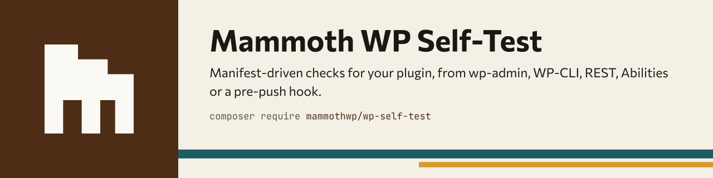
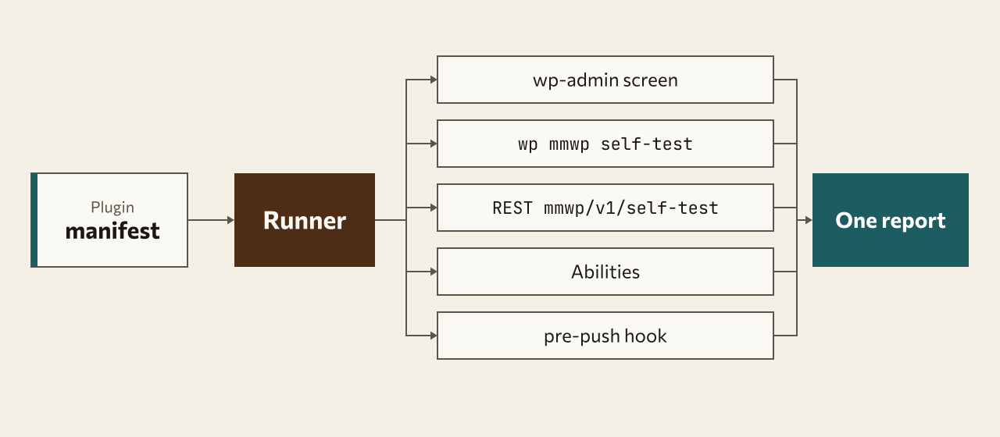

<h1 align="center">
<picture>
  <source media="(prefers-color-scheme: dark)" srcset="docs/assets/banner-dark.svg">
  
</picture>
</h1>

A manifest-driven self-test suite for WordPress plugins. A plugin ships a
`manifest.json` and a few case classes in its own folder; the package runs
them on a real site with removable test data and exposes the same runner
on five surfaces:

| Surface | Where |
|---|---|
| wp-admin | Tools › Self-test (only when the environment is not `production`) |
| REST | `mmwp/v1/self-test/{cases,preview,run,cleanup,report}` (same gate) |
| WP-CLI | `wp mmwp self-test [<slug>]` and `wp mmwp self-test list\|preview\|run\|cleanup\|report` |
| Abilities API | `mmwp/self-test-{list-cases,preview,run,cleanup,get-report}` (WP 6.9+) |
| Browser | Playwright admin crawl and flow tests, `wp mmwp self-test run --layer=browser` (non-production only) |
| Pre-push hook | `bin/pre-push`, `bin/run.php` |

Several plugins can register manifests; the dashboard, commands and report
show every case with the plugin it belongs to, and the dashboard can be
filtered by plugin and by surface (REST / WP-CLI / Abilities).

## How it works

<picture>
  <source media="(prefers-color-scheme: dark)" srcset="docs/assets/diagram-dark.svg">
  
</picture>

## Install in a plugin

```bash
composer require mammothwp/wp-self-test
```

Source of truth: GitLab `mammothwp/wp-self-test`; `github.com/mammothwp/wp-self-test`
is a push mirror (issues and Packagist point there).

The package is a runtime dependency because the dashboard, the command and
the abilities execute inside WordPress. Nothing boots when the environment
(`WP_ENV` if defined, else `wp_get_environment_type()`, i.e. the
`WP_ENVIRONMENT_TYPE` environment variable; `production` when unset) is
`production`, because a run creates data on the site: no commands,
abilities, dashboard or manifests. `mmwp_self_test_enabled` overrides that
per request — return `true` to smoke-test a production site, or `false` to
skip e.g. front-end requests. Elsewhere the commands and abilities always
register, the dashboard, its REST routes and the WP_CLI shim follow
`mmwp_self_test_ui_enabled` (also off on `production`), and every surface
requires `manage_options` (filter `mmwp_self_test_capability`).

Composer's `autoload.files` loads `bootstrap.php`, which registers this
copy of the package. When several active plugins bundle copies, the newest
boots and the rest stay dormant, so committing your vendor directory is
safe.

## Running it

| From | Command |
|---|---|
| wp-admin | Tools › Self-test (`?page=mmwp-self-test`), non-production only |
| WP-CLI | `wp mmwp self-test <slug> --format=table` runs one plugin's cases; without `<slug>` it runs every case. Actions: `list`, `preview`, `run [--cleanup]`, `cleanup`, `report`. Exits 1 when a case fails. |
| REST | `GET mmwp/v1/self-test/cases`, `GET .../preview`, `POST .../run`, `POST .../cleanup`, `GET .../report` (cookie + `X-WP-Nonce`, `manage_options`) |
| Abilities | `mmwp/self-test-list-cases`, `-preview`, `-run`, `-cleanup`, `-get-report`; run and cleanup need `confirm: true` |
| Pre-push | `bin/pre-push` via `bin/install-hooks`, or `php bin/run.php` (see below) |

`<slug>` is the plugin slug passed to `Registry::register()`. A plugin whose
slug equals an action name (`list`, `run`, ...) has to use `--plugin=<slug>`.

## Register a manifest

```php
add_action('mmwp_self_test_register', function (\MammothWP\SelfTest\Registry $registry) {
    $registry->register('my-plugin', __DIR__ . '/self-test/manifest.json', [
        'label'        => 'My Plugin',
        'requirements' => ['abilities', 'logger'],            // optional: valid `requires` keys
        'cli_loaders'  => [['My_Plugin_Cli_Shim', 'load']],   // optional, see "CLI wrappers"
    ]);
});
```

`self-test/manifest.json`:

```json
{
    "version": 1,
    "cases": [
        {
            "id": "content-crud",
            "label": "Custom content CRUD",
            "category": "content",
            "layers": ["rest", "cli", "ability"],
            "class": "My\\Plugin\\SelfTest\\Content_Crud_Case",
            "requires": [],
            "args": {},
            "covers": {
                "rest": ["my-plugin/v1/items", "my-plugin/v1/items/{id}"],
                "cli": ["my-plugin items list"],
                "ability": ["my-plugin/list-items"]
            }
        }
    ]
}
```

Case ids must be unique across every registered plugin. `covers` is
documentation the package carries along (your own tests can assert every
route, command and ability you register is claimed by a case).

## Write a case

```php
use MammothWP\SelfTest\Case_Base;

class Content_Crud_Case extends Case_Base
{
    public function preview()  { return ['Create an item over REST', 'Read it back over the CLI', '…']; }

    public function run()
    {
        $o = [];
        $o['create'] = $this->rest('POST', '/my-plugin/v1/items', ['title' => 'Self-test']);
        $o['cli']    = $this->cli(['My_Cli', 'get'], [$o['create']['data']['id']], []);
        $o['get']    = $this->ability('my-plugin/get-item', ['id' => $o['create']['data']['id']]);
        return ['observed' => $o, 'id' => $o['create']['data']['id']];
    }

    public function validate(array $context)
    {
        $o = $context['observed'];
        return [
            $this->check('rest', 'POST /items returns 201', $this->status($o, 'create') === 201, $this->detail($o, 'create')),
            $this->cli_check($o, 'cli', 'wp my-plugin items get prints the item'),
            $this->ability_check($o, 'get', 'my-plugin/get-item returns the item', fn($data) => !empty($data['id'])),
        ];
    }

    public function cleanup(array $context)
    {
        delete_item((int) $context['id']);
        return ['Deleted the test item.'];
    }
}
```

Four phases, each callable on its own: `preview()` (no side effects),
`run()` (returns a JSON-serialisable context, may create data),
`validate($context)` (turns observations into `check()` / `skip()` rows),
`cleanup($context)` (removes what `run()` created; the runner stores the
context so cleanup can happen in a later request). Helpers: `rest()`,
`cli()`, `ability()`, `status()`, `detail()`, `cli_check()`,
`cli_check_printed()`, `ability_check()`, `availability()`.

## CLI wrappers

Cases call CLI command handlers in-process. In a real `wp` process that is
WP-CLI itself; in PHPUnit, the dashboard and `bin/run.php` it is the shim
in `src/Wp_Cli_Shim.php`, a minimal `WP_CLI` that records output and
throws instead of exiting. Command classes that `return` early when
`WP_CLI` is missing are declared again by the `cli_loaders` callables a
plugin passes to `register()`; the runner calls them once before a run.

## Browser layer

The `rest`, `cli`, `ability` and `core` layers never load wp-admin in a
browser, so JavaScript errors, screens that fail to render and broken form
flows go unnoticed. The `browser` layer runs [Playwright](https://playwright.dev)
against the real site through the same manifest, runner and pre-push hook.
It never runs on production and nothing of it loads on front-end requests.

### Add it to a plugin

1. Add the Node package straight from this git repo (no npm registry), plus Playwright, next to the plugin's `manifest.json` (the folder with the `node_modules` the runner finds is searched from the manifest upwards):

   ```json
   {
       "devDependencies": {
           "@mammothwp/wp-self-test-e2e": "git+https://github.com/mammothwp/wp-self-test.git#main",
           "@playwright/test": "^1.50.0"
       }
   }
   ```

   Then `npm install` and `npx playwright install chromium`. The `package.json` sits at the repo root with a `files` whitelist (only `e2e/`), and every Node file is `export-ignore`d, so the Composer copy in `lib/` never contains it.

2. Declare browser checks on a case in `manifest.json`:

   ```json
   {
       "id": "admin-smoke",
       "label": "Admin smoke",
       "class": "MammothWP\\SelfTest\\Browser_Case",
       "category": "admin",
       "browser": {
           "crawl": true,
           "specs": ["self-test/e2e/coupon-flow.spec.js"],
           "allow": {
               "console": ["Failed to load resource.*gravatar"],
               "requests": ["/wp-json/some/v1/known-404"],
               "pages": ["^admin\\.php\\?page=legacy-screen$"]
           },
           "timeout": 300
       }
   }
   ```

   | Key | Meaning |
   |---|---|
   | `crawl` | `true` opens the front page once and every page of the admin menu inventory (GET only) and requires HTTP 200, no `Fatal error`/`Warning`/`Notice`/`Deprecated`/`WordPress database error`/"There has been a critical error" markup, no console errors, no uncaught page errors (`pageerror`), no `>= 500` response on any request and no `>= 400` wp-json or admin-ajax response. |
   | `specs` | Playwright spec files, relative to the folder with `node_modules` (no `..`). |
   | `allow` | Per-plugin allow-lists of regular-expression sources: `console` (messages), `requests` (`"STATUS URL"`), `pages` (inventory paths to skip). |
   | `timeout` | Seconds the Node runner may take (default 300). |

   A case with `browser` automatically lists the `browser` layer (add `"layers": ["rest"]` as before for the other layers). Use `Browser_Case` for browser-only cases, or your own `Case_Base` subclass to combine PHP phases with browser checks. Put `crawl` in one case only; every case with `browser` starts its own Node run.

3. Write a flow test, e.g. [`docs/examples/coupon-flow.spec.js`](docs/examples/coupon-flow.spec.js). The browser is already logged in:

   ```js
   const { test, expect, openAdminPage, fillForm, submitForm, expectNotice, expectNoBrowserErrors } = require('@mammothwp/wp-self-test-e2e');

   test('create a coupon', async ({ page, collector }) => {
       await openAdminPage(page, 'admin.php?page=ewp-coupons&action=new');
       await fillForm(page, { code: 'E2E10', amount: '10' });
       await submitForm(page, { button: 'Save' });
       await expectNotice(page, { type: 'success' });
       expectNoBrowserErrors(collector);
   });
   ```

   Helpers: `openAdminPage(page, path)` (200 and no PHP error markup), `fillForm(page, {name|id|label: value})`, `submitForm(page, {button})`, `expectNotice(page, {type, text})`, the `collector` fixture (console errors, page errors, wp-json/admin-ajax responses) and `expectNoBrowserErrors(collector, allow)`. Flow tests that create data must delete it themselves.

### Run it locally

| What | Command |
|---|---|
| Browser layer only | `wp mmwp self-test run --layer=browser` (DDEV: `ddev wp mmwp self-test run --layer=browser`) |
| One plugin | `wp mmwp self-test run --layer=browser --plugin=<slug>` |
| Everything incl. browser | `wp mmwp self-test run` |
| Without WP-CLI | `php bin/run.php --layer=browser --plugin=<slug>` |

The runner shells out to Node only when Node and `@mammothwp/wp-self-test-e2e` are found (in DDEV, give the web container Node via `nodejs_version` and run `ddev exec npx playwright install --with-deps chromium`); otherwise the browser checks are reported as **skipped** with the reason, never as failures. `MMWP_E2E_WORKERS` (default 4) sets the parallel pages; `MMWP_E2E_STRICT_TLS=1` turns on TLS verification (off by default because DDEV's local CA is often not trusted by Chromium). Pages are crawled in parallel (4 workers by default) to keep a crawl of ~100 pages under about 2 minutes; raise `MMWP_E2E_WORKERS` if yours is slower.

`bin/pre-push` runs the browser layer after the tests when `package.json` depends on the e2e package: through DDEV, or through `MMWP_SELF_TEST_BROWSER_CMD` (any command, e.g. `wp --path=/srv/site mmwp self-test run --layer=browser`). A stopped DDEV or missing Node prints a warning and skips; a failing browser check blocks the push; `MMWP_SELF_TEST_BROWSER=0` turns the step off.

### Standalone CLI (CI without the PHP runner)

For the shared plugin CI (`test:browser` against a throwaway WordPress with the plugin activated) the crawler runs on its own, configured by flags or environment variables:

```bash
npm install --no-save "@mammothwp/wp-self-test-e2e@git+https://github.com/mammothwp/wp-self-test.git#main" @playwright/test
npx playwright install chromium

MMWP_E2E_ALLOW_PASSWORD_LOGIN=1 \
npx mmwp-e2e crawl --url="$WP_SITE_URL" --user=admin --password="$WP_ADMIN_PASSWORD" \
    --only-plugin="$PLUGIN_SLUG" --json=mmwp-e2e-results.json --junit=junit-browser.xml
```

| Flag | Environment | Meaning |
|---|---|---|
| `--url` | `MMWP_E2E_SITE_URL` | Site URL. |
| `--token` | `MMWP_E2E_LOGIN_TOKEN` | Single-use login token (instead of a password). |
| `--user`, `--password` | `MMWP_E2E_USER`, `MMWP_E2E_PASSWORD` | Admin credentials through `wp-login.php`. **Refused unless `MMWP_E2E_ALLOW_PASSWORD_LOGIN=1` is set**, which only a CI job on a throwaway site should do; never use it against a real site. |
| `--only-plugin` | `MMWP_E2E_ONLY_PLUGIN` | Crawl only admin pages whose URL or parent menu slug contains the slug (`-`/`_` alike). The front page is always crawled. |
| `--allow-console`, `--allow-requests`, `--allow-pages` | `MMWP_E2E_ALLOW_CONSOLE`, `_REQUESTS`, `_PAGES` (comma-separated) | Allow-lists of regular-expression sources; flags are repeatable. |
| `--spec` | | Also run a flow spec (relative to the working directory); repeatable. |
| `--rest-url` | | Base of the `mmwp/v1/self-test/` REST routes. Default `<url>/?rest_route=/mmwp/v1/self-test/`, which works with any permalink setting. A missing route falls back to scraping the admin menu. |
| `--json`, `--junit` | `MMWP_E2E_RESULTS`, `MMWP_E2E_JUNIT` | Results JSON (default `mmwp-e2e-results.json`) and JUnit XML (omitted when unset). |
| `--workers` | `MMWP_E2E_WORKERS` | Parallel pages, default 4. |

The exit code is 0 when every check passed and 1 when one failed or the run broke. The page list comes from `admin-menu` when the site has this package active, otherwise it is scraped from the admin menu HTML with the same exclusions. `npx mmwp-e2e --help` prints the options.

### Listed pages mode (`mmwp-e2e pages`)

`crawl` opens every admin menu page. When a plugin wants an explicit list of admin **and** frontend pages instead (so failures are about the plugin, not about WooCommerce's heavy screens), describe them in `browser-pages.json` and run:

```bash
MMWP_E2E_ALLOW_PASSWORD_LOGIN=1 \
npx mmwp-e2e pages --url="$WP_SITE_URL" --file=browser-pages.json --vars=vars.json \
    --user=admin --password="$WP_ADMIN_PASSWORD" --json=mmwp-e2e-results.json --junit=junit-browser.xml
```

```json
{
  "version": 1,
  "pages": [
    { "area": "admin", "name": "Settings", "path": "/wp-admin/admin.php?page=my-plugin", "as": "admin", "expect": "#my-plugin-form" },
    { "area": "admin", "name": "Product", "path": "/wp-admin/post.php?post=${PRODUCT_ID}&action=edit", "as": "admin", "expect_url": "action=edit" },
    { "area": "frontend", "name": "Shop", "path": "/shop/", "as": "guest", "expect": ".products" },
    { "area": "frontend", "name": "Old URL", "path": "/old/", "as": "guest", "status": 200, "expect_url": "/new/" }
  ],
  "setup": [],
  "about": "ignored by the crawler"
}
```

| Key | Meaning |
|---|---|
| `path` (required) | Starts with `/`. `${VAR}` is replaced from `--vars`; an unknown variable fails that page with a clear message. |
| `as` (required) | `admin` reuses the logged-in session, `guest` has no cookies. Every page gets a fresh browser context, so carts and sessions never leak between pages. |
| `area` | `admin` or `frontend` (default: `admin` for paths under `/wp-admin`). Reporting only. |
| `name` | Label in the report (default: the path). |
| `expect` | CSS selector that must exist on the page. |
| `expect_url` | Substring the final URL (after redirects) must contain. |
| `status` | Expected HTTP status of the final response, default 200. |
| `note`, `setup`, `about` | Ignored by the crawler (`setup` is run by ci-templates). |

Unknown keys print a warning; a missing/invalid `path` or `as` aborts before any browser starts (exit 1). Each page gets the same checks as `crawl` (HTTP status, PHP Fatal/Parse/Warning/Notice/Deprecated markup, critical-error and database-error pages, console and page errors, responses >= 500, REST/admin-ajax >= 400, honouring `--allow-console`) plus `expect` / `expect_url`. Flags: `--url`, `--file`, `--vars` (JSON object file), `--user`, `--password`, `--workers` (default 4), `--timeout-ms` (default 30000), `--allow-console` (repeatable), `--json`, `--junit`. The JSON has `checks` (one per page, `<area>/<as>: <name>`) and `rows` (name, area, as, path, final URL, `duration_ms`, result, problems). Exit code 1 when any page fails.

### Admin menu inventory

`GET mmwp/v1/self-test/admin-menu` (cookie + `X-WP-Nonce`, same capability and `mmwp_self_test_ui_enabled` gate as the dashboard routes) returns `{admin_url, pages: [{title, url, path, parent}], excluded, source}` for the current user. Many plugins register their pages only when `is_admin()` is true, so the menu is snapshotted on `admin_menu` in real admin requests (`source: snapshot`) and the crawler loads one admin page first; without a snapshot the route falls back to the live globals. URLs containing `action=`, `nonce`, `customize.php`, `update.php`, `update-core.php`, `plugin-install.php`, `theme-install.php`, `post-new.php` (it creates an auto-draft) or `logout` are excluded; change the list with the `mmwp_self_test_admin_menu_exclusions` filter.

### Security model

- The runner issues a random 256-bit token for the acting user (`Login_Token::issue()`), stored only as a SHA-256 hash in the `mmwp_self_test_login_tokens` option, valid for 120 seconds and redeemable once.
- It reaches the Node process through an environment variable (not argv, so not in `ps`), and Node exchanges it with `POST mmwp/v1/self-test/browser-login` for the normal auth cookies. Spent, expired, unknown or wrong tokens get a 403.
- After the run, `Login_Token::revoke_all()` destroys every session the exchange created and deletes all records, also when the run fails.
- Never issued or redeemed when the environment is `production` (`WP_ENV`, else `wp_get_environment_type()`), whatever `mmwp_self_test_enabled` / `mmwp_self_test_ui_enabled` return; the routes are also only registered when the dashboard gate is on, and the user must still hold the self-test capability.
- Tokens exist only while a browser run is in progress; there is no standing back door and no password handling.

## The pre-push hook in a consumer

```json
{
    "scripts": {
        "test": "bash tests/run-tests.sh",
        "post-install-cmd": ["@php vendor/mammothwp/wp-self-test/bin/install-hooks"]
    }
}
```

`install-hooks` writes `.githooks/pre-push` (a two-line shim that execs the
package's `bin/pre-push`), makes it executable and sets
`core.hooksPath`. On `git push` the hook skips tag-only and delete pushes,
`php -l`s every tracked PHP file, then runs `composer run-script test`
(or `tests/pre-push.sh`). A push that passes the hook is the gate; the
package ships no CI template (`git push --no-verify` bypasses the hook, so
treat that as a deliberate decision).

`bin/run.php` boots WordPress through your PHPUnit bootstrap
(`--bootstrap=tests/bootstrap.php`, `--autoload=tests/vendor/autoload.php`)
and runs every manifest with cleanup, exiting 1 on failure. Plugins without
a bootstrap can point `phpunit.xml` and `bin/run.php` at
`phpunit/bootstrap.php` with `MMWP_PLUGIN_FILES=/path/to/plugin.php`.

## Filters and actions

| Hook | Kind | Signature |
|---|---|---|
| `mmwp_self_test_register` | action | `(Registry $registry)` — fired at `init` 0 |
| `mmwp_self_test_booted` | action | `(string $path, string $version)` |
| `mmwp_self_test_completed` | action | `(array $report)` |
| `mmwp_self_test_manifest` | filter | `(array $manifest, string $path, string $plugin)` |
| `mmwp_self_test_capability` | filter | `(string $capability)` default `manage_options` |
| `mmwp_self_test_enabled` | filter | `(bool $enabled, string $environment)` — whether the package boots at all on this request; default `true` unless the environment is `production` (since 0.7.0). Return `false` on e.g. front-end requests, `true` to run on production. |
| `mmwp_self_test_ui_enabled` | filter | `(bool $enabled, string $environment)` — dashboard, its REST routes and the shim; default `true` unless the environment (`WP_ENV` if defined, else `wp_get_environment_type()`) is `production`. |
| `mmwp_self_test_shim_enabled` | filter | `(bool $enabled)` default: UI enabled |
| `mmwp_self_test_abilities_available` | filter | `(bool $available)` |
| `mmwp_self_test_ability_definitions` | filter | `(array $definitions)` |
| `mmwp_self_test_asset_url` | filter | `(string $url, string $relative)` |
| `mmwp_self_test_admin_menu_exclusions` | filter | `(string[] $needles)` — substrings that keep an admin URL out of the browser crawl (since 2.1.0). |
| `mmwp_self_test_browser_command` | filter | `(string[] $command, string $package, array $definition)` — how the Node runner is started (since 2.1.0). |

State (last report, contexts awaiting cleanup) lives in the
`mmwp_self_test_state` option.

## Brand

Naming, identifiers and the (deliberately small) visual rules live in
[docs/BRAND.md](docs/BRAND.md).
